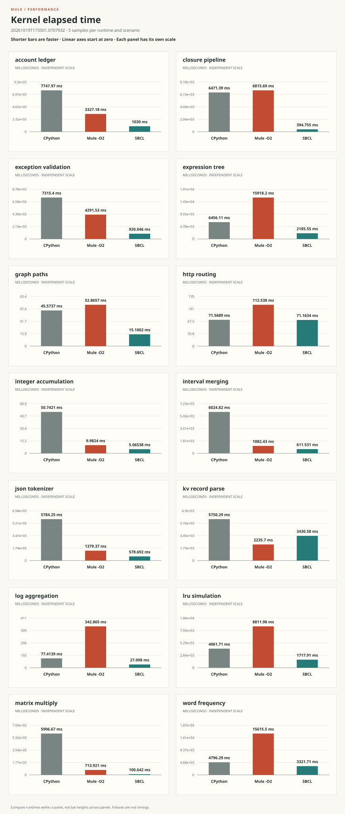
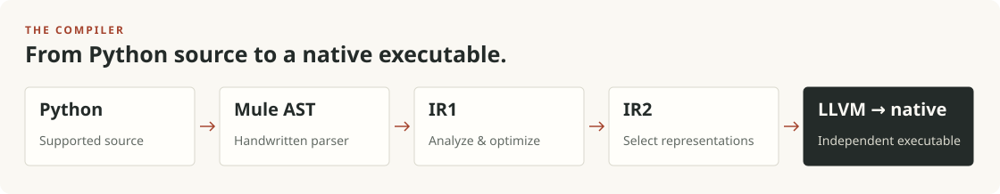

# Mule

**Python, compiled to native code.**

Mule is an experimental ahead-of-time Python compiler with an LLVM backend.
It turns supported Python programs into native Linux executables, with its own
runtime and no dependency on a CPython installation. No bytecode evaluator.
No interpreter fallback.

[Quick start](#quick-start) · [Performance](#performance) ·
[Architecture](#architecture) · [Specifications](spec/index.md) ·
[Website source](docs/index.html)

> **Early-stage compiler, not a drop-in Python replacement.** The parser targets
> Python 3.14 syntax; native compilation supports a smaller subset. Unsupported
> compiler syntax is rejected rather than executed through CPython. See the
> [implemented contracts](spec/native-compiler.md) and
> [compatibility tests and gaps](conformance/README.md).

## Quick start

Build on **64-bit Linux** with **uv**, **Clang**, **Rust with its bundled LLVM
LLD linker**, and the **GMP shared library** installed. The compiler host uses
free-threaded Python **3.15t**, selected by `.python-version`.

```sh
git clone https://github.com/justinvanwinkle/mule.git
cd mule
uv sync
uv run mule -c 'print(40 + 2)'
```

The first run compiles and caches a native executable. Subsequent runs reuse it
while its compiler and source inputs remain unchanged.

Run a file, or build an executable explicitly:

```sh
uv run mule examples/factorial.py
uv run python -m mule.compiler examples/factorial.py \
  -o build/factorial --emit-llvm build/factorial.ll
./build/factorial
```

The command also supports `-m module` and source from stdin. Ordinary builds use
LLVM `-O1`; select `-O3` for maximum optimization and `--lto` separately for
cross-language link-time optimization. Rust runtime primitives always use
optimization level 3. See the [command and build reference](spec/native-compiler.md).

## Performance

The chart below includes **all 14 workloads** from the recorded October 28,
2026 suite run. It compares Mule `-O2` without LTO and SBCL with CPython 3.15.0.
Each panel shows median elapsed **milliseconds** for CPython, Mule, and SBCL.
**Shorter bars mean faster execution.** Every panel uses its own linear scale
starting at zero. Compare bar heights within a workload, not across panels.
These are kernel timings, not compilation or end-to-end application timings.



Five samples per runtime and workload, one warmup, seed 42. Inputs use each
scenario's default size. The run used four concurrent scenario jobs, so timings
may include contention. Preparation and result validation are outside the kernel
timer. Each result was checked against CPython. SBCL runs corresponding Common
Lisp implementations, not the Python sources.

**This is a measured snapshot, not a general speed claim.** The measured checkout
was `0a9e3e863`. Mule still trails CPython on
several workloads. Raw samples, variation, commands, input sizes, hashes, and
revision identity are in the [published results](docs/assets/results.json).
The [report HTML source](docs/assets/index.html) also includes whole-process timings.
Use the [local site preview](docs/README.md#preview-locally) to view the rendered report.

Run a new comparison or inspect the recorded history:

```sh
uv run python -m perf.suite.perfutils run \
  --config perf/runtimes.example.toml --samples 3
uv run python -m perf.suite.perfutils history --last 10
```

The comparison additionally requires SBCL. Builds finish before timing starts;
runtime order rotates between samples. See the [suite methodology](perf/README.md)
and [performance investigation](spec/performance.md) for scope and limitations.

## Architecture

Mule follows SBCL's compiler architecture, historically called **Python**, adapted
to Python semantics and an LLVM backend. The pipeline is explicit:



- **Specialize from evidence.** Known calls, inferred types, declared contracts,
  and representation proofs enable direct calls and native operations.
- **Keep Python independent.** The parser constructs Mule's own syntax tree.
  Generated programs do not link CPython or delegate execution to it.
- **Compile the language implementation.** Runtime protocols are moving into
  Mule Python. Rust supplies low-level primitives; existing language-level Rust
  implementations remain bootstrap work to migrate.

Start with the [SBCL source reference](spec/sbcl-compiler.md),
[native lowering](spec/native-lowering.md), and
[remaining compiler work](spec/compiler-gaps.md).

## Explore and contribute

| Area | Start here |
| --- | --- |
| Language and executable support | [Native compiler](spec/native-compiler.md) |
| Syntax tree and parser API | [Parser](spec/parser.md) · [AST](spec/ast.md) |
| Python compatibility | [Conformance suite](conformance/README.md) |
| Benchmarks and recorded runs | [Performance suite](perf/README.md) · [History](perf/history.jsonl) |
| Design and implementation contracts | [Specification index](spec/index.md) |
| Initial GitHub Pages site | [Site files and publishing instructions](docs/README.md) |
| License | [GNU Affero General Public License v3.0 or later](LICENSE) |

```sh
uv run pytest
uv run ruff check mule test
uv run ruff format --check mule test
```

The default test run excludes expensive integration suites. Run
`uv run pytest -m integration` when changing the behavior they cover.
The conformance oracle uses CPython 3.14, matching the vendored standard library;
it is separate from the compiler host and the baseline in the performance chart.

The parser is also available independently:

```python
from mule.parser import parse

module = parse("answer = 40 + 2\n", filename="example.py")
expression = parse("40 + 2", mode="eval")
```

Parsing returns Mule AST objects; it does not execute the source.

---

<details>
<summary><strong>Contributor and coding-agent reference</strong></summary>

This file is both the project overview and repository guidance for coding agents.
`README.md` is a relative symlink to `AGENTS.md`; edit this file, not a separate
README copy. The instructions below apply whether this section is expanded or not.

## Performance design goal

Every operation in a compiled program must be as efficient as it theoretically
could be with the technology available: given all the information derivable
from the program, the compiler produces the most specialized, most efficient
final machine code. A generic runtime call is acceptable only where the program
leaves the operation genuinely unknown, and even then the dispatch itself must
be the cheapest correct form. CPython has no effective JIT; a statically
compiled program with the same information available to it has no reason to be
slower on any operation, and should be faster on most.

The way to reach that goal is architecture, not special cases. A fast path for
one type in one runtime primitive hides the missing compiler work and does not
transfer to the next program. Derive specialization from the program: known
calls, inferred and declared types, constant bindings, ownership and escape
facts, and representation selection, as SBCL does. Where a hot operation is
slow, first identify which information the compiler already had and failed to
use, or which analysis would have produced it, and build that. Measure the
instruction count of the operation against what the information permits, and
treat the gap as the defect. Special cases may be added later, when an
operation is already as specialized as its information allows and a measured
remainder justifies them.

## Mandatory SBCL architecture

ALWAYS refer to how SBCL does it. Before designing or implementing any compiler,
module-compilation, FASL/object-loading, build, or runtime feature, STOP and
inspect the corresponding source in `~/checkout/sbcl` FIRST (before writing or
proposing any design). Follow its compiler stages, data structures, analyses,
invariants, representation selection, optimization and safety policies, FASL
compilation and loading model (`src/compiler/main.lisp` `compile-file`,
`src/code/module.lisp` `require`/`module-provide-contrib`,
`src/code/load.lisp` and `src/code/target-load.lisp` `load`), and runtime
boundaries. This is a beat-by-beat compiler clone in the Python context, not
loose inspiration.

Never invent bespoke mechanisms (such as ad-hoc IPC pipe servers, environment
variables passing live-image module lists into compilation, bundling transitive
dependencies into dynamic shared objects, or spawning the compiler CLI on a
cache hit) when SBCL already has an established architecture:

- **One source file compiles to one standalone FASL (`module.so`):** Dynamic
  module compilation (`compile-file`) produces a single-module FASL independent
  of what happens to be loaded in the running image. Cross-module imports inside
  a FASL resolve at load/execution time through the runtime module loader.
- **Runtime loading checks the FASL cache directly before invoking the
  compiler:** `load` / `require` looks up the deterministic compiled FASL on
  disk and loads it directly (`dlopen`) on a cache hit without spawning or
  consulting the compiler. Only a cache miss invokes `compile-file`.

Doing anything differently from SBCL requires CLEAR REASONS AND JUSTIFICATION.
Before implementing a departure, document the relevant SBCL files and functions,
what SBCL does, the proposed difference, why it is necessary, and its semantic
and performance consequences in the relevant `spec/` document. Python semantics,
LLVM, and the approved implementation languages require adaptations, but they
are not blanket justifications: explain each concrete departure. Convenience,
missing compiler infrastructure, or an easier Rust implementation do not by
themselves justify a different architecture. Identify missing stages explicitly
and implement the corresponding compiler machinery.

**SBCL parity is the completion standard.** Do not commit, merge, or report a
compiler task as complete until the answer to "Is this at least as good as SBCL?"
is unambiguously **yes**:

- **Stage and mechanism parity:** The analysis or transformation lives in the
  same compiler phase and uses the same producer/consumer IR architecture as
  SBCL (for example, IR1 `deftransform` / `seqtran` rather than ad-hoc inspection
  during VOP code emission, and `locall` / `ltn` / `ir2tran` call-convention
  selection rather than post-pass VOP surgery or throwaway compilation probes).
- **Generality and coverage parity:** It handles the full domain SBCL handles
  (annotated and unannotated functions, self and mutual recursion, closures,
  mixed scalar and descriptor conventions, and general bounds/lengths), not a
  narrow subset tailored to a single benchmark or test case.
- **No test workarounds for compiler gaps:** If a natural program form (such as
  a top-level annotated recursive function) fails to get the optimization, treat
  that as an unfinished defect in the compiler and fix it before completing the
  task. Never reshape a test to work around a case where Mule still trails SBCL.

The compiler is written in Python and must eventually self host. Language-level
runtime and standard-library code must be written in Mule Python and compiled
by Mule, as SBCL compiles its Lisp language implementation. This includes class
construction, attribute and descriptor semantics, method dispatch, containers,
and builtin algorithms. Rust is limited to low-level primitives such as memory
allocation and lifetime support, OS and thread services, and approved foreign
library interfaces. Existing Rust language-level implementations are bootstrap
debt to migrate, not a precedent for extending that boundary.

When compiler proofs permit it, emit direct LLVM arithmetic, field access,
native layouts, and direct calls, following SBCL's corresponding mechanisms.
Dynamic language paths belong in compiled Mule code backed by low-level
primitives. Do not replace missing compiler work with a Rust evaluator or
per-operation Rust language dispatch. Verify optimization claims with optimized
IR or machine code and representative benchmarks. Ordinary builds default to
LLVM `-O1`; use explicit `-O3` for maximum-optimization measurements and record
whether `--lto` is enabled. Rust remains at optimization level 3. Those flags
alone do not establish efficient code.

## Object-oriented design

We want GOOD OO in the compiler and its tools (`mule/`). Behavior that varies by
type belongs to the type: each class answers for itself through its own methods,
through a visitor (`NodeVisitor`, `ast.Visitor`), or through double dispatch, as
the value types in `mule/compiler/ctype.py` do. Do not use `isinstance` or
`issubclass` in `mule/`, and do not substitute other type tests for them:
`type(x) is C`, comparing type names, probing with `hasattr` or `getattr`
defaults, or tag fields that a caller switches on.

This departs from SBCL, whose compiler switches on IR structure types with
`typecase`, `etypecase`, and `typep` (for example `ir1-optimize-block` in
`src/compiler/ir1opt.lisp`). SBCL keeps its IR in `defstruct`s, where a type
test compiles to a type-code check and generic functions would be slower. In
Python a method call costs no more than a type test, and dispatch keeps each
type's behavior beside its definition: a new IR class implements its methods
instead of being added to every type switch that should have named it, and a
switch cannot silently miss a case. Keep SBCL's phases, names, and data flow;
express its type switches as methods or visitors.

Good OO here means:

- A class owns the behavior that differs by its type; callers ask, they do not
  inspect. A method that only one family of types implements belongs on a base
  class whose default states the general answer or raises with context when no
  general answer exists. Never return a silent default that hides a missing case.
- Choose the dispatch mechanism by what varies: a method when the receiver's
  type decides; a visitor when an operation spans a class hierarchy and lives
  apart from it (a compiler phase over IR nodes); double dispatch when two
  operands' types decide together.
- Keep classes cohesive and their state private to their methods. Prefer
  composition for behavior that varies independently of the class hierarchy.
- Tests may check types; they observe behavior from outside.

Before finishing a change to `mule/`, `grep -rn "isinstance(\|issubclass(" mule/`
must print nothing.

## Contracts to preserve

- Approved implementation languages are Python and Rust. The compiler is written
  in Python and must eventually self host; language-level runtime code is compiled
  Mule Python, and low-level runtime primitives are written in Rust.
  Do not add C/C++ implementations or C test probes. LLVM IR is the compiler's
  output. Historical `old/` code and explicitly requested comparison programs
  do not establish permission to use other implementation languages.
- Mule is an alternative implementation of Python. Never link generated programs,
  Mule's runtime, or native test executables against CPython, for any reason.
  Do not include CPython headers or use its runtime or evaluator fallbacks.
  CPython-compatible C extension support must be implemented by Mule.
- Discuss every new third-party library with the user before including it.
  Linked libraries must be LGPL or more permissively licensed; GPL is allowed
  for non-linked uses. GMP is approved under its LGPLv3-or-later option.
  See `spec/dependencies.md`. Running the Python compiler host or an explicitly
  requested external CPython benchmark does not permit CPython linking.
- The parser builds `mule.ast` nodes directly, independently of the host Python
  parser. Do not substitute `ast.parse`, `compile`, or host-AST conversion for
  Mule's parser.
- Python 3.14 grammar is the current syntax reference. Coverage includes modern
  syntax, but the existing suite does not establish complete CPython parity.
- `parse` supports `exec`, `eval`, and `single`; preserve their distinct root
  types and input boundaries. See `spec/parser.md`.
- Lines start at one, columns at zero, and columns count Unicode characters,
  not UTF-8 bytes. Spans exclude the end position. See `spec/ast.md`.
- Assignment targets and values share expression node types. Target grammar is
  checked by the parser; scope and other semantic compiler validation are a
  separate responsibility.
- Source errors carry the supplied filename and source location. Do not recover
  from invalid syntax by returning a partial or empty tree.
- Keep shared token state in `Parser`; grammar mixins operate on that state.
  Interpolation fragments must retain coordinates relative to the original source.
- Reject unsupported compiler syntax explicitly, including unreachable source.
  Do not add execution fallbacks through the host parser, compiler, or evaluator.
- Never emit LLVM `alwaysinline` (or Rust `#[inline(always)]`) on generated
  functions, internal helpers, adapters, or runtime primitives. Unconditional
  inlining runs before LLVM's CGSCC inliner, expands helpers into cold and
  fallback paths, inflates caller instruction counts, and blocks LLVM from
  inlining user and protocol functions where specialization matters. Leave
  inlining decisions to LLVM.
- Preserve evaluation order, dynamic global lookup, and owned-reference cleanup
  on success and error paths. `None` is an object, not an unbound-slot marker.

## Change and verification workflow

Use `~/bin/ws <branch>` for all repository work, then merge completed changes
back to `master`:

- A request to implement a change in this repository authorizes creating its
  branch and worktree through `~/bin/ws`, committing the verified changes, and
  merging them back into local `master`. Do not ask for separate approval for
  these steps. Complete the workflow through the merge and worktree cleanup;
  do not stop with uncommitted changes or a completed branch. This authorization
  does not include pushing, amending commits, or rewriting history.
- Never edit or commit directly on `master` in `/home/jvanwinkle/repos/mule`.
  Branch names must never contain `/` (use hyphenated names such as
  `builtins-migration`).
- From `/home/jvanwinkle/repos/mule`, start `~/bin/ws <branch>` as a background
  daemon session (`IsDaemon=True`) so the interactive `ws` subshell and its lock
  stay open while working in `/home/jvanwinkle/repos/mule-worktrees/<branch>`.
  When local `master` has commits ahead of `origin/master`, run
  `~/bin/ws <branch> --base master` and send `y` to confirm.
- Do not run `git worktree add` directly, create `/tmp` worktrees, or launch
  subagents with `Workspace="branch"` or `Workspace="share"`. Subagents must
  use `Workspace="inherit"` (or their own `~/bin/ws` worktree).
- Report the branch name and absolute worktree path when starting or handing off
  work.
- When changes are verified, commit them on `<branch>` inside
  `/home/jvanwinkle/repos/mule-worktrees/<branch>`, merge `<branch>` into
  `master` in `/home/jvanwinkle/repos/mule` (`git merge --ff-only <branch>`),
  and send `exit` to the `ws` subshell so `ws` removes the clean worktree
  directory. Report when `ws` removes the worktree.

Read the relevant specification, implementation, and nearby tests before changing
a contract. Keep changes in the active package unless the task explicitly concerns
`old/`. Preserve unrelated worktree edits.

Use pytest-native functions and parameterization. Existing tests construct
expected Mule trees by hand; use `test/mule/parser/ast_query.py` for structural
comparisons and targeted node/span queries. Do not make the parser under test
generate its own expected tree. Test valid syntax and relevant rejection
boundaries, including source positions when the change affects them.

Run focused tests while developing, then the full suite for parser or AST changes:

```sh
uv run pytest test/mule/parser/test_entry_points.py
uv run pytest test/mule/compiler
uv run pytest
uv run pytest -m integration
```

The default run excludes tests marked `integration`: suites that build
hundreds of programs (conformance, corpus), run CPython's own stdlib suites,
build at `-O3`, or compile large stdlib modules such as `typing`. Run them
explicitly when a change affects what they cover. Keep default tests targeted:
check compiler output directly where it shows the behavior, build small native
programs that use only the builtins unit, pass `workers=1` to builds (pytest
already runs tests in parallel), and mark anything heavier `integration`. Do
not override `XDG_CACHE_HOME` when running tests or benchmarks; Mule's cache
hashes every compiler and runtime input, so overriding `XDG_CACHE_HOME` adds
no isolation or benefit.

Use three measured runs per runtime and workload for performance comparisons.
Keep warmups separate from measured runs. Preserve the actual sample counts in
historical measurements when updating documentation or reports.

Run comparable benchmarks the same way every time. Keep the runtime configuration,
optimization and LTO settings, workload inputs, seed, loops, warmups, sample count,
CPU affinity, and concurrency unchanged. The standard suite uses `--jobs 4`;
do not switch to serial timing or change established settings without the user's
agreement. Record the exact invocation and settings with each result.

Monitor system load before and throughout benchmark runs. Check CPU utilization
and competing processes, memory pressure and swapping, and disk I/O contention.
Distinguish the expected load from the configured benchmark jobs from unrelated
activity. If unrelated activity materially interferes with timing, stop the run
or mark its results unsuitable for comparison. Report the interference and rerun
with the same settings after it clears; do not silently change concurrency.

Spot-check actual output for every behavior or performance change against its
intended effect. Passing tests alone is not sufficient.

Compiler optimizations need distinct correctness, code-generation, and performance
checks. None substitutes for the others:

- **Correctness:** Compare observable results and relevant effects with the Python
  oracle. Cover the affected ownership, mutation, and error boundaries.
- **Code generation:** Add a realistic regression program that exercises the
  operation through normal language constructs and the actual runtime algorithms.
  Use runtime inputs so constant folding cannot remove the work under examination.
  Inspect optimized IR or machine code with the optimization and LTO settings
  being measured. Include separately compiled runtime units when they contain
  the operation. Do not substitute an isolated synthetic helper for the real path.
- **Efficiency assertions:** Check that the expected native operations occur in
  the relevant loop or specialized path. Check that the targeted calls, dispatch,
  checks, allocations, or ownership traffic disappear or become cheaper there.
  Follow helper calls and data dependencies so moving work into another helper
  cannot satisfy the test. Permit required cold fallbacks outside that path.
  Do not reject unrelated reachable helpers or rely on exact instruction counts,
  temporary identifiers, or complete IR snapshots.
- **Failure evidence:** Run the regression before the fix when practical.
  Confirm that it fails for the missing optimization, not setup, parsing, or
  toolchain errors. An IR verifier proves validity, not efficient code generation.
  Do not weaken the efficiency assertion or mark it expected-failing merely to
  accept an implementation that misses its goal.
- **Performance:** Confirm claimed speedups with representative before/after
  timings on an otherwise idle machine. Do not use loaded-machine measurements
  to accept or reject an optimization. If the expected improvement is absent,
  report the unmet goal instead of treating passing correctness tests as completion.

Check changed Python files with Ruff; format only intended files. Documentation
changes do not require rerunning parser tests unless behavior also changes.
Update affected specifications when changing behavior. Separate implemented
contracts from proposals, and do not describe future compilation stages as available.

## Specifications

Start with `spec/index.md`. The files describe the current frontend and native
compiler, document SBCL's architecture, and record requirements for later stages.
They do not establish complete Python or C extension compatibility.

## Repository map

- `mule/ast.py`: syntax node dataclasses, operator enums, source coordinates,
  and tree traversal.
- `mule/parser/__init__.py`: public `parse` export.
- `mule/parser/core.py`: entry points, token cursor, diagnostics, identifier
  normalization, and shared parser state.
- `mule/parser/lexer.py`: handwritten scanner, indentation, tokens, and lexical
  source positions.
- `mule/parser/expressions.py`: expression grammar and precedence.
- `mule/parser/statements.py`: statements, suites, definitions, and type parameters.
- `mule/parser/patterns.py`: structural pattern matching grammar.
- `mule/parser/strings.py`: literal decoding and formatted/template interpolation.
- `mule/compiler/main.py`: compilation driver (`compile_toplevel`), following SBCL `main.lisp`.
- `mule/compiler/node.py`: IR1 structures (ctrans, lvars, nodes, leaves, lambdas, blocks, components, cleanups), following `node.lisp`.
- `mule/compiler/ir1tran.py`: AST-to-IR1 conversion with scope classification and semantic validation, following `ir1tran.lisp`.
- `mule/compiler/ir1tran_lambda.py`: lambda and module-body conversion, native initialization proof, following `ir1tran-lambda.lisp`.
- `mule/compiler/ir1util.py`: IR1 graph construction and surgery, following `ir1util.lisp`.
- `mule/compiler/dfo.py`: depth-first ordering, unreachable-block deletion, and component splitting, following `dfo.lisp`.
- `mule/compiler/debug.py`: `check_ir1_consistency`, following `debug.lisp`.
- `mule/compiler/knownfun.py` and `mule/compiler/fndb.py`: known-operation metadata and the database of Python operations and runtime protocols, following `fun-info.lisp`/`fndb.lisp`.
- `mule/compiler/policy.py`: optimization policy qualities, following `policy.lisp`.
- `mule/compiler/ir1opt.py`: IR1 optimization loop: literal folding, flushing unused flushable calls, constant branches, following `ir1opt.lisp`.
- `mule/compiler/loop.py`: dominator and natural-loop analysis and IR1 loop-invariant code motion, following `loop.lisp`.
- `mule/compiler/constraint.py`: flow-sensitive propagation of variable facts, relational difference constraints, and node types, following `constraint.lisp` and `equality-constraints.lisp`.
- `mule/compiler/locall.py`: local-call analysis: guarded calls through module globals, entry contexts, optimistic argument/result solving, following `locall.lisp`.
- `mule/compiler/checkgen.py`: decides which casts become runtime checks, following `checkgen.lisp`.
- `mule/compiler/envanal.py`: environment analysis: closed-over variables and cleanup-point insertion for handler, `finally`, and `with` regions, following `envanal.lisp`.
- `mule/compiler/vop.py`: IR2 structures (templates, VOPs, TNs, storage classes, primitive types, IR2 blocks), following `vop.lisp`.
- `mule/compiler/vmdef.py`: template definition and lookup (`define_vop`), following `vmdef.lisp`.
- `mule/compiler/ltn.py`: lvar annotation and per-call template selection by primitive type and policy, following `ltn.lisp`.
- `mule/compiler/ir2tran.py`: IR1-to-IR2 conversion: one VOP sequence per block and entry context, following `ir2tran.lisp`.
- `mule/compiler/represent.py`: storage-class selection per TN and native representation plans, following `represent.lisp`.
- `mule/compiler/vops.py`: the LLVM backend's templates and generators for every known operation, raw native variants, compiled-protocol primitives, and runtime helper templates.
- `mule/compiler/codegen.py`: LLVM module generation over IR2: bodies per entry context, ownership slots, error edges, external entries, native adapters, imports, and `main`, following `codegen.lisp`.
- `mule/compiler/modules.py`: static module resolution and compiled initialization.
- `mule/compiler/ctype.py`: language-level value types (SBCL CTYPE): polymorphic facts, joins, arithmetic, and representation proofs.
- `mule/compiler/annotation_types.py`: imported numeric contracts and optimization policies.
- `mule/compiler/native_protocol.py`: compile Mule class protocols and bind physical primitives.
- `mule/compiler/protocols.py`: the compiled-protocol primitive table (underscored names to known functions and templates) and the protocol compilation entry.
- `mule/compiler/argument_protocol.py`: generate compiled signature binders and constructor forwarding.
- `mule/compiler/sequence_protocol.py`: compile sequence/exception protocols and bind physical primitives.
- `mule/compiler/format_protocol.py`: compile formatting protocols and bind text storage primitives.
- `mule/runtime/lib.rs`: Rust runtime crate and native ABI.
- `mule/runtime/object.rs`: tagged values, heap objects, calls, and ownership.
- `mule/runtime/classes.rs`: fixed instance layouts, immutable method tables,
  attribute caches, and receiver binding.
- `mule/runtime/arguments.rs`: borrowed positional/keyword buffers and captured default storage.
- `mule/runtime/sequences.rs`: physical sequence storage, protocol tables, and exception state.
- `mule/runtime/builtins.rs`: builtin functions and module execution.
- `mule/runtime/numeric.rs`: native integer fast paths and bigint operations.
- `mule/runtime/gmp.rs`: direct GMP bindings and owned bigint wrapper.
- `mule/runtime/annotations.rs`: borrowed assertions at checked annotation boundaries.
- `mule/runtime/native_storage.rs`: raw payload allocation, layout guards, and int64 boxing.
- `mule/compiler/driver.py`: program assembly (`compile_program`), Clang compilation, and executable linking.
- `mule/__main__.py`: the `mule` command (`python`-style `mule script.py`, `-m`, `-c`, `-`).
- `mule/compiler/__main__.py`: `python -m mule.compiler` executable builder.
- `mule/compiler/cache.py` and `mule/compiler/inputs.py`: cached executables for the
  `mule` command, validated against every source file read or probed.
- `test/mule/parser/`: parser and AST tests, fixtures, and AST query helpers.
- `test/mule/compiler/`: IR1, IR2/code generation, runtime, and native executable tests.
- `conformance/`: authored Python feature programs compared with CPython as the oracle;
  `gaps.toml` records known Mule gaps. See `conformance/README.md`.
- `test/conformance/` and `tools/record_conformance_gaps.py`: conformance discovery,
  comparison, and gap recording.
- `examples/`: native compiler examples and upstream performance reference programs.
- `examples/benchmarks-game/`: unmodified Python 3, Rust, SBCL, and Go comparison sources,
  upstream licenses, expected outputs, and source hashes in `UPSTREAM.json`.
- `mule_types/__init__.py`: numeric annotation markers and the `optimize` compiler directive, separate from the `mule` compiler package.
- `stdlib/mule_types.py`: relative symlink to the annotation package for compiled module resolution.
- `stdlib/_native_class.py`: compiler-private class construction and field protocols compiled by Mule.
- `stdlib/_arguments.py`: compiled general constructor forwarding.
- `stdlib/_sequences.py`: compiled sequence, iterator, and exception algorithms.
- `stdlib/_format.py`: compiler-private formatting rules compiled by Mule.
- `stdlib/bootstrap/unittest.py`: initial assertion API compiled by Mule for simple upstream suites.
- `tools/run_stdlib_tests.py`: attempt all upstream suites and report native execution separately from compilation.
- `examples/mule_types.py` and `perf/suite/mule_types.py`: relative symlinks to the annotation library for direct host Python runs.
- `spec/`: initial specifications and explicit boundaries of implemented behavior.
- `old/`: earlier implementations, including Python bootstrap code, Common Lisp,
  LLVM experiments, a C++ runtime, and generated artifacts. Treat these as
  historical reference, not the active build or a specification for new behavior.

## Benchmarks Game performance examples

`examples/benchmarks-game/` contains all Python 3, Rust, SBCL, and Go variants
from the official Computer Language Benchmarks Game source archive for these
ten workloads: binarytrees, fannkuchredux, fasta, knucleotide, mandelbrot, nbody,
pidigits, regexredux, revcomp, and spectralnorm. There are 183 programs: 41 Python,
61 Rust, 33 SBCL, and 48 Go. Source bytes and contributor notices are unchanged;
only extensions were changed to `.py`, `.rs`, and `.lisp`. Upstream variant
identifiers remain in the filenames. Each workload retains its BSD license and
small-input expected output. `UPSTREAM.json` records the download URL, archive
SHA-256, original paths, local paths, and individual file hashes.

These are external comparison programs, not Mule runtime dependencies or a claim
that Mule can compile their Python features. Some variants require external
libraries, older toolchain features, SIMD, or multiple workers. Do not install
new libraries implicitly or rewrite reference algorithms to obtain a successful
Mule build. Record the variant, toolchain, flags, input, and worker count with
performance results; different upstream variants need not use identical
algorithms or parallelism.

Start with the dependency-free base nbody variants. Build outside the timed run:

```sh
mkdir -p build/benchmarks-game
rustc -C opt-level=3 --crate-name nbody examples/benchmarks-game/nbody/nbody.rs \
  -o build/benchmarks-game/nbody-rust
go build -o build/benchmarks-game/nbody-go examples/benchmarks-game/nbody/nbody.go
sbcl --noinform --no-sysinit --no-userinit --non-interactive \
  --eval '(declaim (optimize (speed 3)))' \
  --load examples/benchmarks-game/nbody/nbody.lisp \
  --eval '(sb-ext:save-lisp-and-die "build/benchmarks-game/nbody-sbcl" :toplevel (function main) :executable t)'
```

Validate against the upstream output before timing. These four invocations have
been checked at input 1000 and produce byte-identical output:

```sh
uv run python examples/benchmarks-game/nbody/nbody.py 1000 > build/benchmarks-game/nbody-python.out
cmp examples/benchmarks-game/nbody/1000_out build/benchmarks-game/nbody-python.out
for language in rust go sbcl; do
  build/benchmarks-game/nbody-$language 1000 > build/benchmarks-game/nbody-$language.out
  cmp examples/benchmarks-game/nbody/1000_out build/benchmarks-game/nbody-$language.out
done
```

For repeated wall-clock and peak resident-memory measurements on Linux:

```sh
for run in 1 2 3; do
  uv run /usr/bin/time -f 'python elapsed=%e seconds maxrss=%M KiB' \
    python examples/benchmarks-game/nbody/nbody.py 1000000 > /dev/null
  for language in rust go sbcl; do
    /usr/bin/time -f "$language elapsed=%e seconds maxrss=%M KiB" \
      build/benchmarks-game/nbody-$language 1000000 > /dev/null
  done
done
```

These timings include process startup but exclude Rust/Go builds, SBCL source
loading/image creation, and uv startup. Increase the input when native runs are
too short for useful measurements. Use an otherwise idle machine and compare
repeated runs, not a single measurement. For stdin workloads (knucleotide,
regexredux, and revcomp), generate one FASTA input with a fasta reference and
reuse that same file across implementations; input generation is not part of
their timed execution. Mandelbrot output is binary PBM, so compare bytes rather
than decoding it as text.

Mule compilation can be attempted separately:

```sh
uv run python -m mule.compiler examples/benchmarks-game/nbody/nbody.py \
  -o build/benchmarks-game/nbody-mule --emit-llvm build/benchmarks-game/nbody-mule.ll
```

Historical Mule nbody measurements are recorded in `spec/performance.md`.
They are separate from the standalone performance suite above. The compiled
`sys.argv` implementation is in `stdlib/sys.py`; its native startup boundary and
remaining compatibility gaps are documented in `spec/compiled-modules.md`.
Validate every new executable against the same upstream output before including
it in comparisons.

</details>
