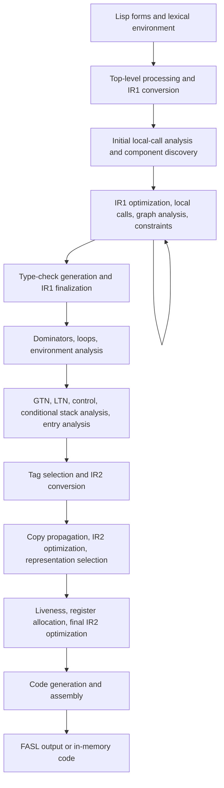

# SBCL's compiler

Status: description of the inspected SBCL implementation, not Mule behavior.

Reference: `~/checkout/sbcl`, commit
`4a997dfc5029cddb4e7fa7f7393e66b427adcca7`. Source references below use paths
relative to that checkout and identify relevant functions or structures. The
[pinned source tree][source] provides the same files for readers without it;
start with the [driver][driver], [IR1 structures][ir1], and [VOP/TN structures][ir2].

The historical `doc/internals/cmu/compiler-overview.tex` supplies terminology,
but current source determines the structures and ordering here.
`doc/internals/README.md` warns that the internals manual is not fully current.

## Overall structure

SBCL separates language-level reasoning from machine implementation. **IR1**,
historically the Implicit Continuation Representation (ICR), records Lisp
operations and explicit control/value flow. **IR2**, historically the Virtual
Machine Representation (VMR), records implementation operations and temporaries
for a target machine. Both are graphs rather than retained source trees.

These are interacting phases, not necessarily complete passes. The driver
retries transformations and refreshes graph analyses after relevant changes.
`main.lisp` contains `compile-toplevel` (line 1546), `ir1-phases` (541),
`compile-component` (713), and `%compile-component` (589).

## Source conversion and compile-time processing

`process-toplevel-form` in `src/compiler/main.lisp:1224` handles macro expansion,
`PROGN`, `LOCALLY`, `MACROLET`, `SYMBOL-MACROLET`, and `EVAL-WHEN`. It distinguishes
compile-time execution from code to execute when compiled output is loaded.
Compilation can execute user Lisp code during macro expansion or compile-time
evaluation.

`src/compiler/ir1tran.lisp` converts forms using a lexical environment.
`ir1-toplevel` (543) creates an initial component and top-level lambda;
`ir1-convert` (630) receives control continuations and a result LVAR. Conversion
resolves bindings to compiler objects and applies source transformations.
`ir1-translators.lisp` handles special forms; `ir1tran-lambda.lisp` handles
functions, parameters, declarations, and entry structures.

Lexical variables and function bindings occupy separate Lisp namespaces.
Global references also use compiler definition information. Resolution does not
make every global call a permanent direct reference: local, known, and general
calls differ. `*derive-function-types*` in `ir1tran.lisp` controls an assumption
that definitions remain stable, with comments explaining its semantic limitations.

Source paths and transformation context survive conversion for diagnostics.
The source syntax itself can be discarded after its semantics are represented
by the graph.

## IR1 structures and invariants

`src/compiler/node.lisp:148` describes control/data separation. Older documents
combine these roles in a continuation; current SBCL uses **CTRAN** for control
and **LVAR** for results.

| Structure | Responsibility | Definition in `node.lisp` |
| --- | --- | --- |
| `component` | Connected compilation unit; blocks, functionals, analysis work, backend state. Not necessarily one source function. | 586 |
| `cblock` | Basic block; predecessor/successor links, control endpoints, DFO, dominators, loops, analysis flags. | 488 |
| `ctran` | Control position leading into a node, with block-start or inside-block linkage. | 170 |
| `lvar` | Result flow with one destination consumer and one or several delivering nodes; may carry multiple Lisp values. | 208 |
| `node` / `valued-node` | Operation, control linkage, source/lexical context, and inferred result information. | 341 / 392 |
| `leaf` / `lambda-var` | Referenced entity or lexical binding; types, references, assignments, closure state. | 844 / 1485 |
| `functional` / `clambda` | Function identity/body, parameters, entry relationships, local-call information. | 1055 / 1256 |
| `optional-dispatch` | Dispatch from a full lambda list to simpler argument-count entry functions. | 1355 |
| `lexenv` | Conversion-time binding, declaration, macro, policy, and cleanup context. | 20 |
| `environment` / `cleanup` | Runtime closure/allocation requirements and protected dynamic regions. | 723 / 698 |

`lvar-uses` are **producer nodes**, despite the field's identifier;
`lvar-dest` is the **consumer**. `lvar-use` at line 314 explicitly returns the
unique delivering node. Multiple producers can deliver to one LVAR, while
source variables and assignments remain explicit. This is not conventional SSA
or LLVM's definition/use model.

Core operations include `ref`, `cif`, `cset`, `combination`, `mv-combination`,
`bind`, `creturn`, `cast`, `entry`, `exit`, and `enclose`. Several structure
identifiers have a `c` prefix to avoid Lisp operator collisions; accessors often
omit it. `cast` represents assertions/checks, `entry` and `exit` represent
non-local control, and `enclose` constructs a closure.

Evaluation order follows the control chain independently of result flow.
Discarding a result does not imply deleting its producing operation. A graph
rewrite must maintain reciprocal block edges, control ownership, producer/result
links, references to leaves, and analysis invalidation.
`src/compiler/debug.lisp:53` (`check-ir1-consistency`) and line 301
(`check-block-consistency`) verify these relationships.

## Local calls and entry functions

`src/compiler/locall.lisp:331` analyzes function references. Direct references
supplying the call operand can become local calls to a known entry. References
that escape or are used as values require an **external entry point (XEP)**.
The XEP provides general argument checking/dispatch while internal entry
functions can use a simpler convention.

Optional/keyword/rest arguments are reduced to simpler function entries.
Some single-use functions become LET-like regions: LET conversion splices the
body into the caller's flow, redirects its results, and shares the caller's
environment (`locall.lisp:1011`). This changes graph connectivity and allocation
requirements. Local-call analysis therefore repeats and can join components.

The call kinds in `node.lisp:1646` include `:full`, `:local`, `:known`, `:error`,
and `:unknown-keys`. A known operation with compiler metadata is distinct from
a local function body eligible for local-call analysis.

## Type inference, constraints, and transformations

SBCL's **CTYPE** describes language-level types, including unions, numeric
ranges, function signatures, and multiple values. It is distinct from machine
storage representation. `src/compiler/ctype.lisp` connects types to IR1 call
checking; `ir1opt.lisp` derives result types and simplifies operations;
`constraint.lisp` propagates flow-sensitive facts.

LVAR result types combine their producers' types (`ir1opt.lisp:170`). Aggregate
contents cannot always retain inferred facts across mutation or arbitrary calls;
`lvar-conservative-type` at line 202 explicitly addresses this issue.
Constraints meet across control-flow joins and iterate over cyclic components
(`constraint.lisp:1789,1922`). Recursive argument/result inference can start
with optimistic empty types. These underapproximations are unsound until the
solver converges and must not be published early (`ir1opt.lisp:3035,3359`).

The known-function database provides an extensible transformation mechanism:

| Source | Contents |
| --- | --- |
| `src/compiler/fun-info.lisp` | Effects, type derivers, constraints, transforms, LTN/IR2 hooks, templates. |
| `src/compiler/knownfun.lisp` | Registration machinery for `DEFKNOWN` and `DEFTRANSFORM`. |
| `src/compiler/fndb.lisp` | Standard/internal operation signatures and semantic information. |
| `src/compiler/srctran.lisp`, `typetran.lisp`, specialized transform files | Source and IR transformations for applicable operations/types. |

`foldable` and `flushable` are distinct (`fun-info.lisp:41`). Computing a result
at compile time requires different evidence from discarding an unused call.
Required errors can prevent flushability even without mutation. Transforms
have type/policy conditions, can decline, and can be delayed until constraints
or a later optimization phase make application appropriate.

`derive-node-type` and `reoptimize-lvar` maintain inferred types, caches, and
dependent work flags (`ir1opt.lisp:374,326`). Invalidation without an actual
change can prevent termination. Block processing clears flags before doing
work so new work requests survive the current pass (`ir1opt.lisp:594`).

`ir1-optimize-until-done` and `ir1-optimize-phase-1` in `main.lisp:413,485`
interleave simplification, local-call analysis, DFO repair, constraints, and
deferred transforms. They enforce iteration limits with special handling for
reanalysis and required versus possible work. This is not a fixed sequence
of independent tree passes.

## Type checks, policy, and finalization

`src/compiler/checkgen.lisp` converts checks too complex for direct backend
emission into explicit IR1 tests. `ir1-phases` optimizes again when check
generation introduces code, joins eligible blocks, then runs `ir1-finalize`.

`policy.lisp` and `policies.lisp` define optimization qualities and derived
policies for speed, safety, debugging, space, and compilation speed. They affect
checks, local transformations, variable preservation, and self-call recognition.
Common Lisp declarations feed this system; an unsafe policy can trust a declared
type. These are SBCL semantics, not Python annotation semantics.

`ir1final.lisp` reports failed optimizations and semantic/type issues and
records definition information. Compilation-unit processing also manages
deferred definition warnings. Compiler errors, style warnings, and optimization
notes are different outcomes.

## Graph and environment analysis

`src/compiler/dfo.lisp` discovers components and maintains reachable blocks and
depth-first order. `compile-component` computes dominators and loop information
before environment analysis, then refreshes graph information after changes.

`environment-analyze` in `envanal.lisp:18` determines closed-over state and
runtime environment requirements. Captured assigned variables require indirect
cells (`compute-closure`, line 82); closure requirements propagate through
referencing functions and can require heap allocation. LET-like function bodies
share their home environment.

The phase also finds non-local exits, determines dynamic extent, inserts cleanup
points, annotates tail positions, and removes unused functions. Cleanup describes
a protected region and applies on exits, not merely at the syntactic end of a
body. Lisp special bindings, `CATCH`, `UNWIND-PROTECT`, `BLOCK`, and `TAGBODY`
contribute cleanup kinds (`node.lisp:686`). Block merging respects cleanup,
home-function, and type-check boundaries (`ir1util.lisp:1911`).

## IR2 and native code generation

IR2 uses **VOPs**, virtual implementation operations, and **TNs**, implementation
temporaries. TNs are not necessarily allocated physical registers. VOP templates
describe operand/result constraints, costs, and generation code. `vop.lisp`
defines IR2 blocks, VOPs, and TN structures; `tn.lisp` and `vmdef.lisp` provide
supporting machinery. Architecture-specific directories supply target operations.

The backend sequence in `src/compiler/main.lisp:589` is:

| Phase | Responsibility | Main source |
| --- | --- | --- |
| GTN | Lexical-variable TNs, environments, argument locations, calling conventions. | `gtn.lisp`, `gtn-analyze` |
| LTN | Choose translations from type/policy information; annotate expression temporaries and delayed operands. | `ltn.lisp`, `ltn-analyze` |
| Control | Arrange blocks for emission. | `control.lisp`, `control-analyze` |
| Stack, conditional | Unknown-value receivers and stack-allocation cleanup. | `stack.lisp`, `stack-analyze` |
| Entry, dominators, tagging | Final entry/runtime information, GC-barrier prerequisites, tagging choices. | `entry.lisp`, `select-tagging.lisp`, driver |
| IR2 conversion | Translate IR1 operations into VOPs. | `ir2tran.lisp`, `ir2-convert` |
| Copy/IR2 optimization | Conditional copy propagation and implementation simplifications. | `copyprop.lisp`, `ir2opt.lisp` |
| Representation selection | Choose boxed/unboxed storage and insert conversions; optimize again. | `represent.lisp`, `select-representations` |
| Lifetime | Compute temporary lifetimes/conflicts and call-save requirements. | `life.lisp`, `lifetime-analyze` |
| Pack | Allocate registers/storage and spills; optimize again after allocation. | `pack.lisp`, `sb-regalloc:pack` |
| Code generation/assembly | Invoke VOP generators and assemble code/fixups. | `codegen.lisp`, `generate-code` |
| Output | Dump FASL or construct an in-memory code component. | `dump.lisp`, driver |

The driver checks IR2, lifetime, and allocation consistency. It removes unused
temporaries before lifetime analysis and releases backend state after emission.
Replacing only the assembler would leave SBCL machine assumptions in earlier
stages, including known-function metadata.

## Runtime, loading, and debug information

The generated code depends on SBCL's runtime: tagged values and heap headers,
closure layouts, local/full calling conventions, multiple-value returns,
allocation, GC barriers, and non-local exits. See
`doc/internals/objects-in-memory.texinfo`,
`doc/internals/calling-convention.texinfo`, and target definitions in
`src/compiler/`. Some manual examples are old or architecture-specific.

`COMPILE-FILE` produces a **FASL** containing compiled components and load
operations. `fasl-dump-component` in `dump.lisp:1322` serializes code, constants,
and entries; `fasl-dump-toplevel-lambda-call` at 1376 emits a top-level execution
operation. `src/code/load.lisp:640,1318` validates groups and executes loader
operations to reconstruct objects and definitions. Compilation into a running
image constructs code/function objects directly. A FASL is a Lisp loading
protocol, not simply a platform shared library.

Source provenance survives conversion and transformations. The driver records
cross-references before optimization (`main.lisp:721`); VOPs retain originating
IR1 nodes (`vop.lisp:550`). `debug-dump.lisp:416,1052` prepares source and
per-component debug information, with final address mappings after assembly.
This includes functions, arguments, variable locations, and code maps.
Optimization policy affects how much state remains visible to the debugger.

[source]: https://github.com/sbcl/sbcl/tree/4a997dfc5029cddb4e7fa7f7393e66b427adcca7
[driver]: https://github.com/sbcl/sbcl/blob/4a997dfc5029cddb4e7fa7f7393e66b427adcca7/src/compiler/main.lisp#L413
[ir1]: https://github.com/sbcl/sbcl/blob/4a997dfc5029cddb4e7fa7f7393e66b427adcca7/src/compiler/node.lisp#L148
[ir2]: https://github.com/sbcl/sbcl/blob/4a997dfc5029cddb4e7fa7f7393e66b427adcca7/src/compiler/vop.lisp#L137
